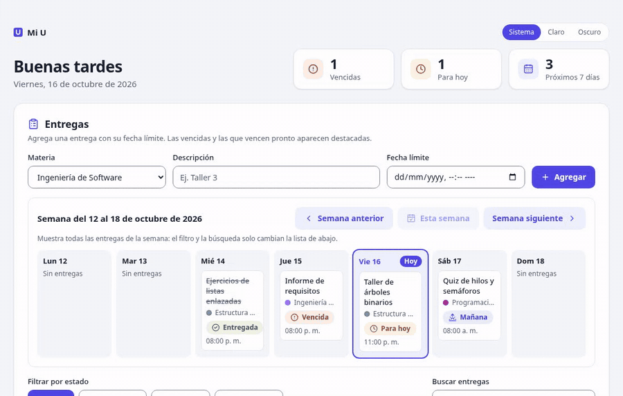
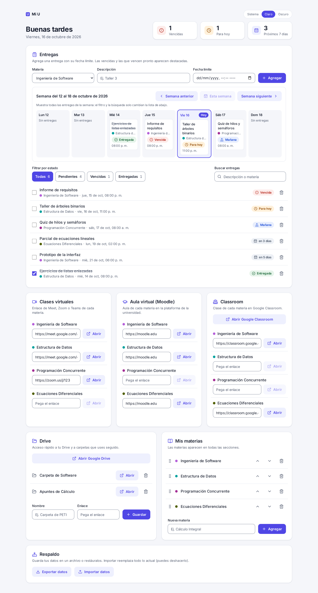
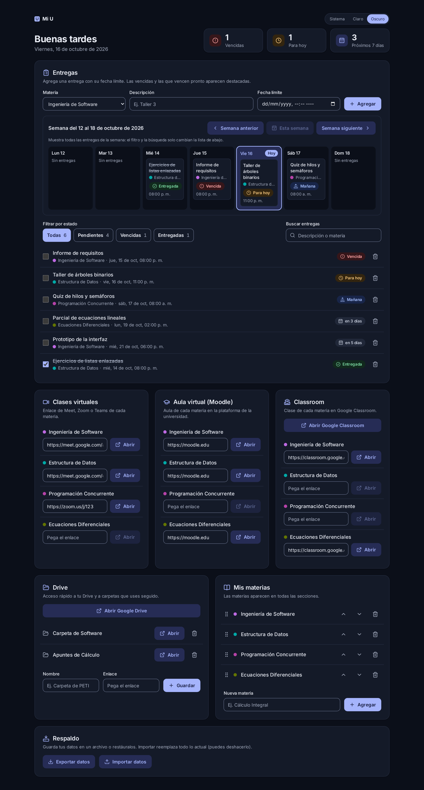

<div align="center">


# Mi U

**Tu vida universitaria en un solo panel.**
Entregas, clases virtuales, Moodle, Classroom y Drive, sin cuentas ni servidores.


[Funciones](#funciones) · [Así se ve](#así-se-ve) · [Instalación](#instalación-y-uso) · [Privacidad](#datos-y-privacidad) · [Desarrollo](#desarrollo)



<sub>Atajo `n` para una entrega nueva, filtro de vencidas, búsqueda con `/` y cambio de tema.
<a href="docs/img/demo.mp4">Ver el video en mejor calidad</a>.</sub>

</div>

## Funciones

- **Entregas:** registra tareas con materia, descripción y fecha límite, márcalas como hechas o bórralas. La lista pone primero las pendientes y al final las entregadas, cada grupo por fecha.
- **Estados:** cada entrega muestra "Entregada", "Vencida", "Para hoy", "Mañana" o "en N días", siempre con icono y texto, no solo con color. Los días se cuentan por calendario, no en bloques de 24 horas.
- **Vista semanal:** siete días de lunes a domingo con todas las entregas de la semana, incluidas las hechas. El día de hoy va resaltado y se puede pasar a la semana anterior o a la siguiente. En pantallas pequeñas los días van apilados.
- **Filtros y búsqueda:** muestra todas las entregas, las pendientes, las vencidas o las entregadas, con la cantidad de cada grupo. Busca por descripción o por materia sin importar mayúsculas ni tildes. El filtro y la búsqueda no se guardan al recargar y no cambian la vista semanal.
- **Resumen:** el encabezado saluda según la hora del día y cuenta las entregas vencidas, las de hoy y las de los próximos 7 días.
- **Avisos:** notificación del navegador cuando faltan 24 horas o menos para una entrega (requiere permiso). Solo funciona con la página abierta: revisa al abrirla y cada minuto.
- **Clases virtuales, Moodle y Classroom:** guarda por materia el enlace de Meet, Zoom o Teams, del aula de Moodle y de la clase de Google Classroom, y ábrelo con un clic. Si el enlace no empieza por `http://` o `https://`, la app le agrega `https://`.
- **Drive:** acceso directo a Google Drive y a las carpetas o enlaces que uses seguido.
- **Materias:** agrega o quita materias; aparecen en todas las secciones. Cada una recibe un color propio para reconocerla de un vistazo, y puedes reordenarlas arrastrándolas o con las flechas. Al quitar una materia, la app pide confirmación y borra también sus enlaces y entregas.
- **Tema:** claro, oscuro o el del sistema, con el selector del encabezado.
- **Respaldo y deshacer:** exporta e importa tus datos en JSON; borrar o importar se puede deshacer.
- **Atajos de teclado:** `/` busca entregas y `n` empieza una entrega nueva.

Todas las fechas se calculan y se muestran en hora de Bogotá (UTC−5), aunque el equipo esté en otra zona horaria.

## Así se ve

| Claro | Oscuro |
|---|---|
|  |  |

<details>
<summary>En el celular</summary>


</details>

Las capturas usan datos de ejemplo.

## Requisitos

- Node.js 22.13 o superior. Se recomienda Node 24 LTS (ver [Pendientes](#pendientes)).
- npm, que viene con Node.

## Instalación y uso

```bash
git clone https://github.com/padilla05x/mi-u.git
cd mi-u
npm install
npm run dev
```

Abre <http://localhost:5173>. Siempre usa esa misma dirección: el navegador guarda los datos por dirección, así que en `127.0.0.1:5173` o en otro puerto verías la app vacía. Por eso el puerto está fijo: si el 5173 está ocupado, Vite se detiene en vez de abrir otro.

| Comando | Qué hace |
|---|---|
| `npm run dev` | Inicia la app en modo desarrollo en <http://localhost:5173>. |
| `npm run build` | Revisa los tipos y genera la versión final en `dist/`. |
| `npm run preview` | Sirve la versión de `dist/` en el mismo puerto, así que ve los mismos datos que `npm run dev`. No pueden correr a la vez. |
| `npm test` | Corre todas las pruebas una vez. |
| `npx vitest` | Corre las pruebas y las repite al guardar cambios. |
| `npm run lint` | Revisa el código con ESLint. |

La versión de `dist/` no se abre con doble clic: hay que servirla con `npm run preview` o con cualquier servidor web.

### Versión anterior

`mi-u.html` es la versión inicial en un solo archivo y sigue en el repositorio hasta que se retire (ver [Pendientes](#pendientes)). Se abre con doble clic en el navegador.

Sus datos no pasan solos a la versión nueva, porque el navegador los guarda por separado según la dirección de la página. Para llevarlos:

1. Abre `mi-u.html`, abre la consola del navegador (F12) y ejecuta:
   ```js
   copy(localStorage.getItem('mi-u-v1'))
   ```
2. Abre <http://localhost:5173>, abre la consola y ejecuta lo siguiente, pegando lo copiado en lugar de `PEGA_AQUÍ`:
   ```js
   localStorage.setItem('mi-u-v1', JSON.stringify(PEGA_AQUÍ))
   ```
3. Recarga la página. Mi U convierte las fechas al formato nuevo y les da color a las materias.

Ojo: el paso 2 reemplaza lo que ya tengas guardado en la versión nueva.

## Datos y privacidad

- **Todo queda en tu navegador.** Los datos viven en el `localStorage`. No hay servidor ni cuentas, y nada se envía a servidores externos. Hasta la fuente (Inter) viene incluida en la app; solo se sale de ella cuando abres un enlace tuyo.
- **Claves que usa:**
  - `mi-u-v1`: materias, entregas y enlaces de Drive.
  - `mi-u-tema`: el tema elegido, solo si no es "Sistema".
  - `mi-u-v1-corrupto`: copia que se crea si los datos guardados aparecen dañados (si ya existe, la siguiente es `mi-u-v1-corrupto-2` y así sucesivamente).
- **Nada se borra en silencio.** Si los datos están dañados, se guarda esa copia, se carga el estado inicial y la app lo avisa. Si el almacenamiento está lleno o el navegador lo bloquea, la app sigue funcionando en memoria y muestra un aviso.
- **Por navegador y dirección.** Si cambias de navegador, de equipo o de dirección, los datos no se transfieren solos.
- **Respaldo.** Antes de limpiar los datos del navegador, conviene exportar un respaldo en JSON desde la app.

## Estructura del proyecto

```
src/
  lib/          lógica pura, sin React, con sus pruebas: fechas, estados, semana,
                filtros, colores de materia, almacenamiento y migración
  components/   una tarjeta por sección y sus piezas compartidas
  hooks/        reloj de la pantalla y avisos del navegador
  App.tsx       arma la página
  index.css     paleta y estilos base (Tailwind CSS)
docs/
  diseno.md     paleta, contraste, tipografía, iconos y reglas de la interfaz
  img/          logo animado, capturas y video de la demo
mi-u.html       versión anterior, en un solo archivo
```

## Desarrollo

- **Stack:** Vite, React, TypeScript, Tailwind CSS, Vitest con Testing Library, ESLint e iconos de Lucide.
- **Pruebas en otra zona horaria.** Corren con la zona de Tokio, para comprobar que la lógica usa la hora de Bogotá y no la del equipo.
- **Diseño.** Las decisiones visuales están en [docs/diseno.md](docs/diseno.md). La prueba `src/diseno.test.ts` comprueba que los colores de `src/index.css` coinciden con ese documento y que cumplen el contraste WCAG AA. Si cambias un color, cámbialo en los dos lados.
- **Antes de proponer un cambio,** corre `npm test`, `npm run lint` y `npm run build`.

## Hoja de ruta

- [x] Reestructurar el proyecto con Vite + React + TypeScript
- [x] Rediseño visual con modo claro y oscuro
- [x] Vista semanal de entregas
- [x] Filtros y búsqueda
- [x] Ordenar materias arrastrándolas
- [x] Exportar e importar datos en JSON
- [x] Deshacer al borrar
- [x] Pruebas unitarias para la lógica de fechas y estados
- [x] Atajos de teclado
- [ ] Elegir a mano el color de cada materia (hoy se asigna solo)

## Pendientes

- [ ] Migrar a Node 24 LTS. Node 25 ya no tiene soporte y Vitest 5 no lo admite; por eso Vitest sigue en 4.1.
- [ ] Retirar `mi-u.html` cuando termine la fase 1. Seguirá en el historial de git (commit `90c1a4d`).

## Licencia

Distribuido bajo la licencia MIT. Consulta el archivo [LICENSE](LICENSE).
